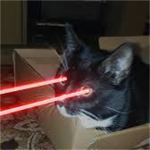
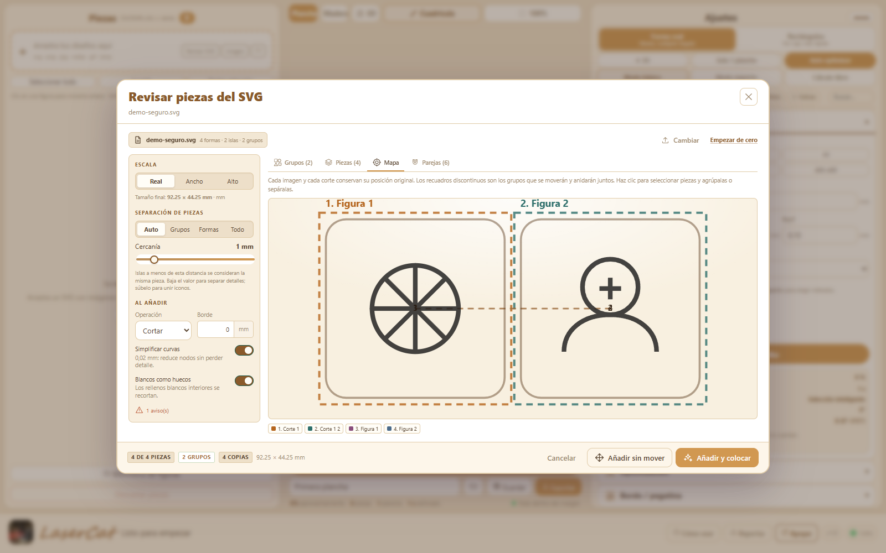
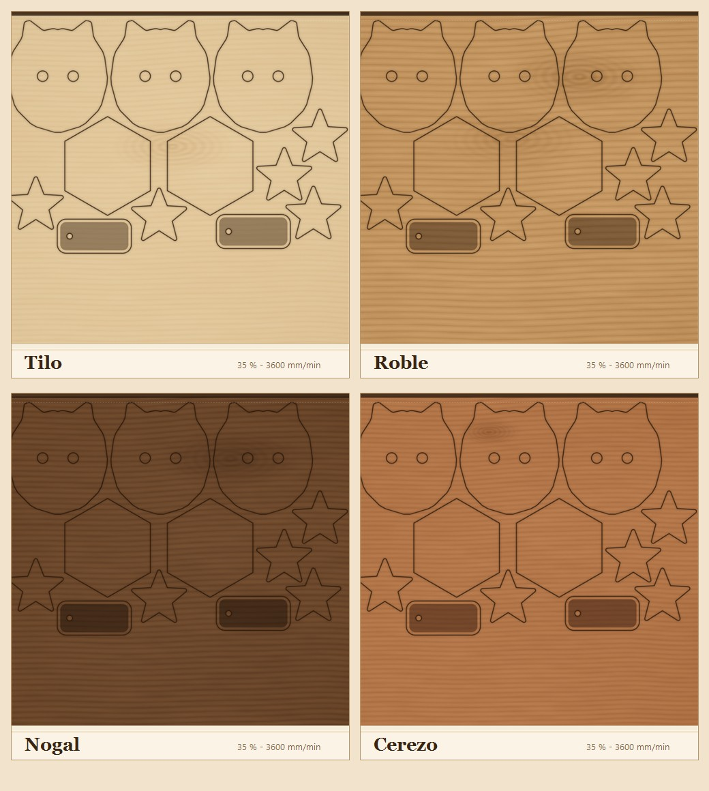
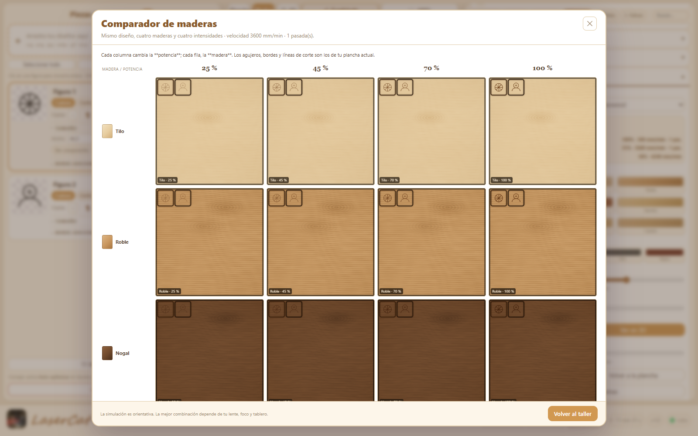
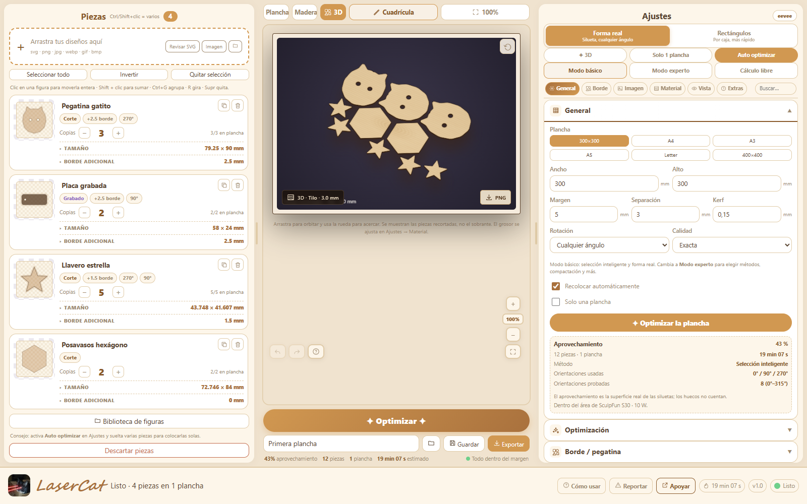
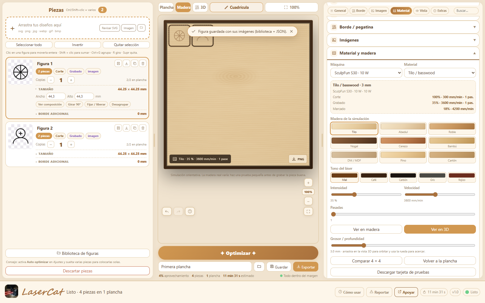
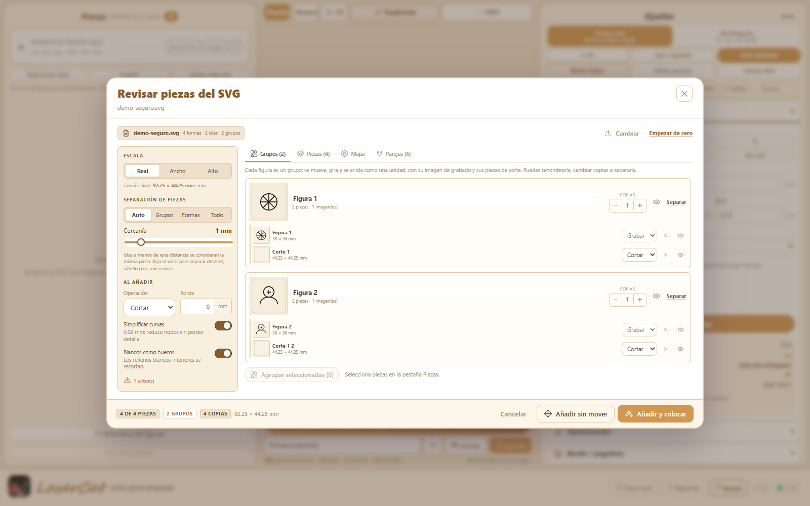
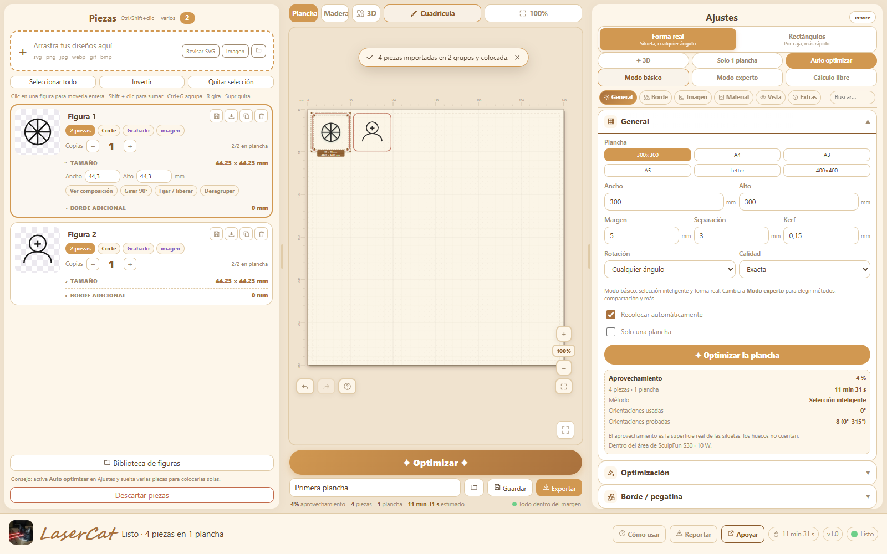
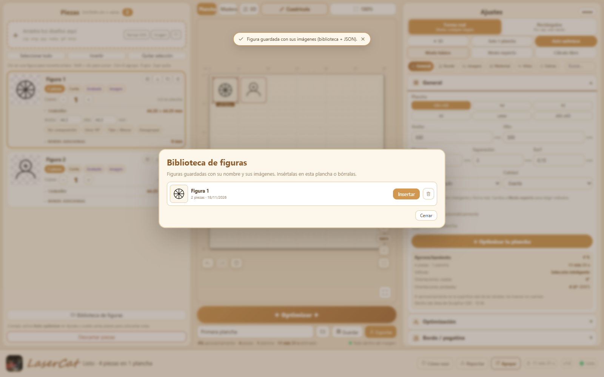
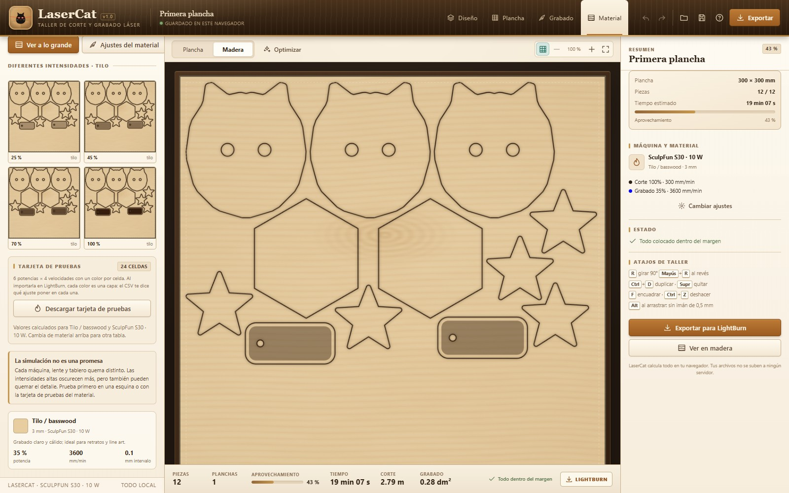

# 🐈 LaserCat

<div align="center">


**Corte y grabado láser, sin pelearte con la plancha.**

[](https://github.com/dhernandezgit/LaserCat/actions/workflows/pages.yml)
[](LICENSE)
[](https://docs.lightburnsoftware.com/)
</div>

LaserCat es un taller local-first para preparar trabajos de láser: importa tus SVG e imágenes,
separa las piezas, agrupa figuras completas, calcula el hueco real entre formas, aplica bordes y kerf,
previsualiza el resultado en distintas maderas y exporta SVG en milímetros listos para **LightBurn**.

Hecho para diodos como la **SculpFun S30 (10 W)**, con **tilo de 3 mm** como material de partida.
Funciona con cualquier láser y cualquier plancha. La interfaz copia la disposición y el flujo de
**CryCat** (tres columnas, tarjetas, barra inferior y temas pastel), adaptada al corte y grabado láser.
Arranca con el tema **Eevee**.

- 🌐 **App:** https://dhernandezgit.github.io/LaserCat/
- 📦 **Repo:** https://github.com/dhernandezgit/LaserCat
- 🪵 Sin servidor, sin cuenta y sin subir archivos.
- 🧩 Todo se guarda en tu navegador; también puedes descargar el proyecto `.json`.


---

## ✨ Qué hace

### Plancha y empaquetado

- **Plancha de 300 × 300 mm por defecto**, con margen de seguridad de **5 mm** y separación de **3 mm**.
- **Empaquetado por forma real**, no por cajas: se rasteriza cada pieza y se comprueba la colisión
  con su geometría, así que una estrella puede encajar junto a la oreja de un gato.
- **4 métodos de colocación** (Greedy/Bottom-Left, Largest First, Voronoi/huecos libres y Genético),
  **3 calidades** (Rápida / Normal / **Exacta**) y **compactación** posterior tipo DeepNest.
- **Rotación** 0°/90°/ múltiplos/ángulo libre, **copias** y **múltiples planchas**. En **forma real** se usan todos los ángulos por defecto; **Rectángulos** limita a 90° para ir más rápido.
- **Kerf** configurable: el corte se compensa hacia el desperdicio para que la pieza final mida lo que debe.
- **Fijar piezas** con el pin (o al arrastrarlas): el resto se recoloca alrededor.
- Aprovechamiento, número de planchas y **tiempo estimado** de corte/grabado en directo.

### Importar SVG de verdad

- **Unidades reales**: mm, cm, pulgadas, puntos, píxeles y `viewBox`.
- **Transformaciones** (`matrix`, `translate`, `scale`, `rotate`, `skew`), `use`, `rect`, `circle`,
  `ellipse`, `line`, `polyline`, `polygon` y rutas completas con curvas y arcos.
- **Imágenes SVG incrustadas** (`<image>` con data URL): se importan como **grabado** y sirven de
  ancla para agrupar los cortes que las rodean; una imagen grande se convierte en una figura que
  engloba sus piezas.
- **Separación inteligente en islas**: un solo `<path>` con 40 iconos se convierte en 40 piezas;
  los ojos, letras y ventanas interiores se mantienen como **agujeros**, no como piezas sueltas.
- **Grupos de Inkscape/Illustrator** respetados como pistas, con nombres de capa.
- **Rellenos blancos → huecos** (opcional): los detalles blancos dentro de una silueta se recortan.
- **Trazos sin relleno** convertidos a contorno de corte del grosor del trazo.
- **Mapa de piezas** con la posición original, colores, **recuadros de figuras** y lista de
  **parejas** (“qué se empareja con qué”). Puedes **fusionar**, **agrupar**, **separar** y renombrar
  antes de añadir.
- Escala por **ancho**, **alto** o tamaño real; simplificación de curvas configurable.
- Pestaña **Grupos** con tarjetas por figura: nombre, copias, miembros, operación, incluir/excluir,
  separar y vista previa con la imagen y los cortes ya montados.

### Figuras y ensamblajes

- Una **figura** es un grupo de piezas que se mueve, gira, fija, duplica y **se anida como una
  unidad**. La imagen grabada y sus cortes mantienen el registro exacto del SVG original.
- **Agrupar** desde el importador o con `Ctrl` + `G` en el tablero; **Desagrupar** desde la tarjeta de la figura.
- Cada figura tiene **copias independientes**, nombre propio y miembros con su operación
  (cortar / grabar / marcar).
- El empaquetado **compacta** las figuras después de colocarlas y puede rotarlas si la plancha lo
  permite, sin romper la alineación interna.
- **Biblioteca de figuras**: guarda una figura con su nombre y sus **imágenes incluidas** y
  reutilízala en otro proyecto. Se descarga un `.lasercat-group.json` con las imágenes en base64 y,
  desde la tarjeta, un **ZIP para LightBurn** con SVG por capas, PNG, CSV y LEEME.




### Imágenes para cortar o grabar

- **Silueta de corte**: contorno + agujeros, ideal para pegatinas y recortes.
- **Grabado B/N**: vector sólido en blanco y negro.
- **Grabado en grises**: mapa de bits con todas las intensidades para fotos.
- **Tramado**: Floyd–Steinberg, Atkinson u ordenado 8×8.
- **Semitono vectorial**: miles de puntos vectoriales, sin imagen incrustada.
- Umbral, invertir, quitar fondo claro, suavizado, tamaño mínimo y **borde/offset**.

### Bordes y pegatinas

- **Offset en mm** calculado sobre la forma final, no sobre la caja.
- El borde expande solo el exterior: **los agujeros conservan su tamaño**.
- Si la pieza es de **grabado**, el diseño se graba y el contorno exterior se corta.
- Opción de **borde separado** para pegatinas de dos capas.
- El kerf se aplica al corte, nunca al grabado.

### Vista en madera

- **Vista 3D de las piezas recortadas**: profundidad configurable (**3 mm por defecto**), órbita con arrastre, inclinación y zoom con la rueda. No muestra el tablero sobrante.
- **9 maderas**: tilo, abedul, roble, nogal, cerezo, bambú, DM/MDF, pino y cartón.
- **5 tonos de láser**: miel, café, carbón, gris y rojizo, para comparar el mismo trabajo con
  distintas quemaduras.
- **Intensidad, velocidad y pasadas** en directo, con halo de quemado y líneas de corte.
- Galería de **4 intensidades** para comparar de un vistazo y **comparador 4 maderas × 4 intensidades**.
- Exporta la previsualización a PNG.
- Simulación orientativa: cada máquina, lente y tablero quema distinto.







### Temas y aspecto

- **Eevee** por defecto: crema, caramelo y paneles claros, con la misma disposición de tres columnas,
  tarjetas redondeadas y barra inferior que CryCat.
- También **Wiwi**, **Sylveon**, **Leafeon**, **Vaporeon**, **Umbreon**, **Fidough**, **Sprigatito**,
  **Maushold**, **Jirachi**, **Espeon** y **Espeon shiny**.
- El tema se cambia desde el **badge de Ajustes → Vista y tema** y se recuerda en el navegador.



### Exportar a LightBurn

- **SVG en milímetros reales** (`width="300mm"`, `viewBox="0 0 300 300"`), sin transformaciones en los vectores.
- **Capas por color**, que LightBurn convierte en capas separadas:
  - Azul `#0000FF` → **GRABADO** (Relleno)
  - Verde `#008000` → **MARCADO** (Línea)
  - Negro `#000000` → **CORTE** (Línea)
  - Magenta `#FF00FF` → **BORDE** (Línea)
  - Rojo `#FF0000` → **MARCAS** (referencia; se puede ignorar)
- Grabado antes que corte en el orden del documento.
- **Kerf**, **puentes de sujeción**, marcas de esquina y **orden de recorridos** por cercanía.
- Imágenes de grabado **incrustadas** en el SVG y también como PNG sueltos en el ZIP.
- Exportación **por figura**: desde su tarjeta, un ZIP compacto con el SVG de esa figura, sus
  imágenes, el CSV de capas y el LEEME.
- El ZIP completo incluye:
  - `*-plancha-01.svg`, `*-plancha-02.svg`…
  - `lasercat-proyecto.json`
  - `ajustes-capas.csv`
  - `LEEME-LightBurn.txt`
  - `imagenes/*.png`
  - `previews/*-madera.png`



### Volver de LightBurn a LaserCat

Para reimportar desde LightBurn una figura con sus imágenes y grupos, exporta un **SVG con las
imágenes incrustadas** (data URL, no enlazadas). LaserCat lo lee, vuelve a detectar las figuras y
separa los cortes. El formato nativo `.lbrn2` conserva capas y grupos, pero todavía no tiene parser;
si compartes un proyecto de ejemplo, se puede añadir soporte nativo. Mientras tanto, el SVG con
imágenes incrustadas es el camino fiable.





### Extras de taller

- **Biblioteca de figuras** guardadas con sus imágenes, nombres propios y miniaturas.
- **Tarjeta de pruebas** de 24 celdas (6 potencias × 4 velocidades), un color por celda y CSV de ajustes.
- **Presets de material** para S30 de 10 W, S30 Pro de 20 W, S30 Ultra de 22 W, diodo de 5 W y COâ‚‚ de 40 W.
- **Historial** con deshacer/rehacer, autoguardado local, proyecto `.json`, atajos y diseño responsive.
- **Sin servidor**: React + TypeScript, todo el cálculo en el navegador.

---

## 🚀 Empezar en 5 pasos

1. Abre **https://dhernandezgit.github.io/LaserCat/** (o ejecuta `npm run dev`).
2. **Arrastra** tus SVG o imágenes a la columna **Piezas** (o al tablero). Se añaden y colocan solos.
3. Revisa las tarjetas: tamaño, copias, borde y operación. Las figuras se mueven y anidan enteras.
4. Ajusta **Plancha** y **Optimización** a la derecha: margen 5 mm, separación 3 mm, kerf 0,15 mm,
   método y calidad. Activa **Auto optimizar** si quieres que se recoloche al cambiar algo.
5. Pulsa **Exportar** e importa el SVG en LightBurn. Para guardar una figura suelta, usa el
   **disquete** de su tarjeta y recupérala desde **Biblioteca de figuras**.

> **Consejo:** la calidad **Exacta** suele meter en una plancha lo que la rápida reparte en dos.
> Si algo no cabe, prueba Exacta o Genético, baja la separación o reduce el borde. Las figuras se
> compactan después de anidar y conservan la alineación entre imagen y cortes.

---

## 🧭 La interfaz

La app sigue la disposición de CryCat: **Piezas** a la izquierda, **visor** en el centro, **Ajustes** a la
derecha y **barra de estado** abajo. Los tres paneles tienen separadores arrastrables.

| Zona | Para qué sirve |
|---|---|
| **Piezas** | Arrastrar archivos, seleccionar, copias, tamaño, borde, operaciones y biblioteca. |
| **Visor** | Plancha/madera, arrastrar, girar, fijar, zoom, páginas, Optimizar y Guardar/Exportar. |
| **Ajustes → General** | Plancha, presets A4/A3/A5/Letter, margen, separación, kerf, rotación, calidad y método. |
| **Ajustes → Optimización** | Método, forma real/rectángulos, compactación y recálculo. |
| **Ajustes → Material → 3D** | Grosor, órbita y piezas recortadas en 3D. |
| **Ajustes → Borde / Imagen / Material** | Offset global, importación de imágenes, madera, tonos, potencia y tarjeta de pruebas. |
| **Ajustes → Vista y tema** | 12 temas CryCat, cuadrícula y leyenda de capas. |
| **Barra inferior** | Cómo usar, reportar, apoyar, versión y estado del taller. |

<p align="center">
  
  <br />
  <sub>La misma plancha en el móvil: los paneles se apilan y el tablero conserva el zoom y los controles.</sub>
</p>

### Atajos

| Atajo | Acción |
|---|---|
| `Ctrl` + `Z` / `Ctrl` + `Mayús` + `Z` | Deshacer / rehacer |
| `Ctrl` + `D` | Duplicar |
| `Supr` | Quitar de la plancha |
| `R` / `Mayús` + `R` | Girar +90° / −90° |
| `Ctrl` + `G` | Agrupar las piezas seleccionadas como figura |
| `F` | Encuadrar |
| `Ctrl` + `A` | Seleccionar todo |
| Flechas | Mover 1 mm (Mayús: 5 mm) |
| `Alt` + arrastrar | Mover sin imán de 0,5 mm |
| `Ctrl` + `S` / `Ctrl` + `O` | Guardar / abrir proyecto `.json` |
| `Esc` | Deseleccionar / cerrar |

> Un clic en cualquier miembro selecciona la **figura completa**; `Mayús` + clic añade o quita figuras.
> `Ctrl` + `O` también acepta un `.lasercat-group.json` guardado desde la biblioteca.

---

## 🪵 Maderas y ajustes de partida

Valores orientativos para **SculpFun S30 de 10 W**. Empieza bajo y ajusta con una prueba pequeña.

| Material | Grosor | Corte | Grabado |
|---|---:|---|---|
| Tilo / basswood | 3 mm | 100 % · 300 mm/min · 1 pasada | 35 % · 3600 mm/min |
| Abedul / contrachapado | 3 mm | 100 % · 280 mm/min · 1 pasada | 38 % · 3300 mm/min |
| Roble | 4 mm | 100 % · 180 mm/min · 2 pasadas | 45 % · 2600 mm/min |
| Nogal | 3 mm | 100 % · 250 mm/min · 1 pasada | 40 % · 3000 mm/min |
| Cerezo | 3 mm | 100 % · 260 mm/min · 1 pasada | 38 % · 3100 mm/min |
| Bambú | 3 mm | 100 % · 200 mm/min · 2 pasadas | 35 % · 3400 mm/min |
| DM / MDF | 3 mm | 100 % · 350 mm/min · 1 pasada | 42 % · 3500 mm/min |
| Pino | 3 mm | 100 % · 380 mm/min · 1 pasada | 32 % · 4000 mm/min |
| Cartón | 2 mm | 70 % · 900 mm/min · 1 pasada | 25 % · 5000 mm/min |
| Cuero vegetal | 2 mm | 60 % · 500 mm/min · 1 pasada | 20 % · 3000 mm/min |
| Acrílico negro | 3 mm | 100 % · 200 mm/min · 1 pasada | 30 % · 3000 mm/min |

Los presets se ajustan automáticamente al cambiar de máquina (S30 Pro y Ultra son más rápidas;
el diodo de 5 W, más lento).

---

## 🖨️ LightBurn, paso a paso

1. Descarga el ZIP en **Exportar**.
2. En LightBurn: **Archivo → Importar** y elige el SVG de la plancha.
3. Comprueba que mide **300 × 300 mm** (o la medida que hayas puesto). No cambies la escala.
4. Los colores crean las capas. Asigna **Relleno** a GRABADO y **Línea** al resto.
5. Ordena las capas: **GRABADO → MARCADO → BORDE → CORTE → MARCAS**.
6. Coloca la madera y usa **Coordenadas absolutas** u **Origen de usuario**.
7. Enfoca, enciende el aire y lanza el trabajo.

**Ajustes del CSV** (ejemplo con tilo y S30):

| Capa | Color | Modo | Potencia | Velocidad | Pasadas |
|---|---|---|---:|---:|---:|
| GRABADO | `#0000FF` | Relleno | 35 % | 3600 mm/min | 1 |
| MARCADO | `#008000` | Línea | 18 % | 3600 mm/min | 1 |
| BORDE | `#FF00FF` | Línea | 100 % | 300 mm/min | 1 |
| CORTE | `#000000` | Línea | 100 % | 300 mm/min | 1 |
| MARCAS | `#FF0000` | Línea | 20 % | 300 mm/min | 1 |

> Los valores son un punto de partida. Haz siempre una prueba en un retal: la lente, el foco,
> la humedad y la madera cambian el resultado.


### Tarjeta de pruebas

En **Material → Tarjeta de pruebas** puedes descargar un ZIP con:

- un SVG de **200 × 150 mm** con **24 celdas** (6 potencias × 4 velocidades),
- un CSV que dice qué potencia y velocidad asignar a cada color,
- un LEEME con instrucciones.

Cada celda incluye un bloque sólido, un círculo fino, un peine de líneas y un damero para comparar
oscuridad, detalle y resolución. Es la forma más rápida de afinar tu madera.



---

## 🧱 Desarrollo

Requisitos: **Node.js 20+**.

```bash
npm install
npm run dev        # http://localhost:5173
npm test           # 59 tests (geometría, importador SVG con imágenes, figuras, nesting geométrico, export, store, tarjeta)
npm run typecheck
npm run build      # dist/ estático
npm run preview
```

### Estructura

```
src/
  lib/
    geom.ts          contornos, áreas, rotaciones, simplificación
    clipper.ts       booleanos y offsets robustos (Clipper)
    svgImport.ts     parser SVG, imágenes incrustadas, unidades, islas y figuras
    autoImport.ts    soltar archivos y añadirlos sin diálogos
    trace.ts         marching squares, umbral, tramado, semitono
    nest.ts          empaquetado por forma real (métodos + compactación)
    assembly.ts      figuras/ensamblajes, geometría combinada y rotación
    groupLibrary.ts  biblioteca, JSON y ZIP por figura
    wood3d.ts        proyección 3D de piezas, grosor y órbita
    themes.ts        los 12 temas pastel de CryCat
    laser.ts         máquinas, materiales, capas, kerf y tiempos
    export.ts        SVG para LightBurn, puentes, ZIP y LEEME
    wood.ts          textura procedural, tonos y simulación de quemado
    testcard.ts      tarjeta de pruebas de 24 celdas
    store.ts         estado, historial, autoguardado y normalización
  components/        diálogos y piezas compartidas
  components/shell/  FilePanel, Viewer, Settings y StatusBar estilo CryCat
  styles.css         estilos de los diálogos y base
  crycat.css         disposición de tres columnas, tarjetas y temas
examples/            SVG e imagen de muestra propios
docs/                capturas para el README
```

### Tests

```bash
npm test           # 59 tests (geometría, importador SVG con imágenes, figuras, nesting geométrico, export, store, tarjeta)
```

Cubren, entre otras cosas:

- Áreas, rotaciones, RDP, offsets con huecos y kerf.
- Importación de SVG con mm/viewBox, transformaciones, trazos, imágenes incrustadas, grupos y blancos como huecos.
- Separación de islas, agrupación por distancia real, figuras automáticas y nombres de grupo.
- Figuras: geometría combinada, offsets, rotación, copias, fijado, biblioteca y JSON con imágenes.
- Tres modos de imagen: silueta, agujeros, marching squares, tramado y semitono.
- Nesting sin solapes reales, respeto del margen, varias planchas y compactación.
- Exportación con capas, kerf, puentes, imágenes y ZIP.
- Historial, copias, pin y normalización de proyectos.
- Tarjeta de pruebas y validez XML.

### Despliegue

El workflow [`.github/workflows/pages.yml`](.github/workflows/pages.yml) compila y publica en
GitHub Pages en cada push a `main`. La app es 100 % estática y usa rutas relativas, así que también
puedes servir `dist/` desde cualquier sitio.

---

## 🔒 Privacidad

- **No hay servidor**: los SVG, imágenes, proyectos y ajustes se quedan en tu navegador.
- El autoguardado usa `localStorage`. Si el proyecto es muy grande, descarga el `.json`.
- No se suben archivos a ningún sitio. No hay cuentas ni analítica.
- La app no modifica tus archivos originales.

---

## ⚠️ Seguridad y descargo

- Usa **gafas de protección** adecuadas para la longitud de onda de tu láser.
- Enciende **extracción/ventilación** y no dejes la máquina desatendida.
- Los ajustes de potencia/velocidad son **orientativos**. Haz pruebas en retales.
- La simulación en madera es una aproximación artística, no una garantía del resultado.
- **LightBurn** es una marca de LightBurn Software. **SculpFun** es una marca de SculpFun.
  LaserCat es una herramienta independiente, sin afiliación ni patrocinio.
- La app se ofrece **tal cual**, sin garantías.

---

## ❤️ Créditos

Hecha por **Daniel Hernández Ferrándiz**, como hermana de [CryCat](https://github.com/dhernandezgit/CryCat-Tool),
la herramienta que colocaba imágenes para Cricut. LaserCat cambia el papel por madera, el plotter por
un diodo y el PNG por SVG en milímetros.

- Inspiración, filosofía, disposición de tres columnas, tarjetas, atajos, temas pastel y barra inferior: **CryCat Tool**, adaptados al láser.
- Icono: recorte cuadrado superior de la foto original de LaserCat.
- Geometría robusta: [clipper-lib](https://github.com/junmer/clipper-lib).
- ZIP: [fflate](https://github.com/101arrowz/fflate).
- Interfaz: React + Vite + TypeScript.

Si te sirve, pásate por el repo y deja una estrella ⭐.

---

## 🇬🇧 English in a nutshell

**LaserCat** is a local-first laser cutting/engraving layout studio. It imports SVGs with real
units, embedded images and groups, splits them into smart islands (holes included), handles white
cut-outs, imports images as silhouettes / B&W / grayscale / dither / vector halftone, builds movable
figures (image engraving + cut pieces), applies sticker offsets and kerf, nests parts and figures
using their true shape with post-compaction, previews the result on nine wood species with five laser
tones, and exports LightBurn-ready SVG in millimetres with colour-coded layers, bridges and a ZIP
containing the project, per-figure exports, layer CSV, embedded raster images and wood previews.
Defaults: SculpFun S30 10 W, 300 × 300 mm sheet, 5 mm margin, basswood 3 mm. Eevee is the default
theme, with Sylveon, Leafeon, Vaporeon, Umbreon and Taller available. No server, no account, no uploads.

Built by **Daniel Hernández Ferrándiz**. MIT licensed.

